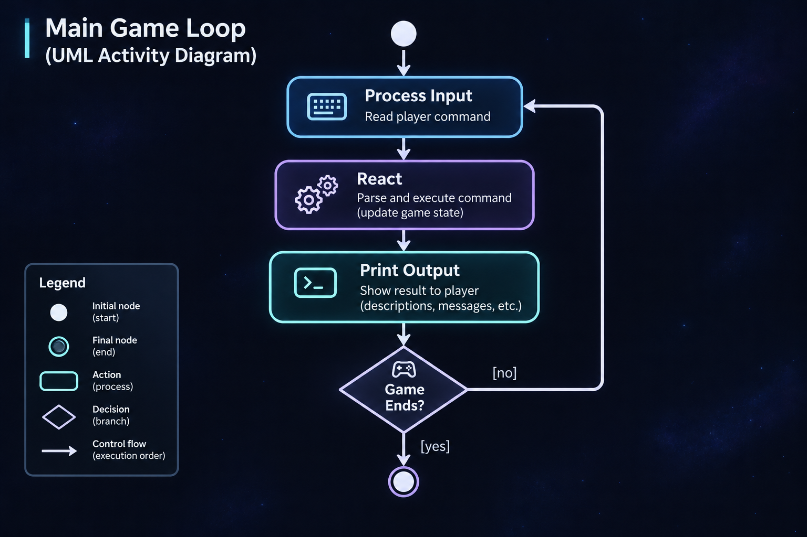
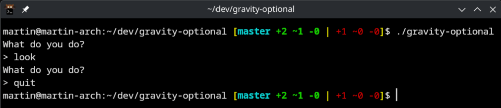

<style>
section.compact li {
    margin: 8px;
    line-height: 1;
}
img {
    max-width: 100%;
    max-height: 50vh;
}
section em {
    font-size: 0.6em;
}
section.compact h2,
section.compact p {
    margin: 0.2em 0;
}
section.compact pre {
    margin: 0.2em 0 0.5em;
    padding: 0;
}
</style>
<!-- _class: lead -->

# Gravity Optional

### Semestral projekt

### Vývoj softwarových aplikací · 2026

Martin Hůla, Tobiáš Lončík

https://github.com/anakreon/gravity-optional

---

# Functional Requirements

Build a Zork-like text adventure in C

- **World Map** – Handcrafted, interconnected rooms
- **Command Parser** – Verb–noun input processing
- **Inventory System** – Item management
- **Save & Load** – Game progress persistence
- **Game Mechanics** – Movement, room descriptions, item and environment interactions
- **Progress Tracking** – Move counter and optional scoring system

---

<!-- _class: invert compact -->

# Technical & Team Requirements

**Project Requirements**

- GitHub repository for version control
- Unit Tests
- Documentation and release package (ZIP + executable)

**Individual Responsibilities**

- Implement at least one game component (mechanic or room)
- Commit only your own work to the repository
- Present a detailed explanation of your implementation
- Understand the entire codebase, not just your own contributions

---

# Gravity Optional

## Story Overview

- An asteroid strike leaves your spaceship crippled and adrift
- You wake up as the only survivor
- Explore the wreckage. Restore what you can. Fight to survive.
- **Against all odds, find your way home!**

---

# Main Game Loop



---

<!-- _class: invert compact -->

# Gravity Optional

https://github.com/anakreon/gravity-optional

**1. Clone the repository**

```bash
git clone <repository-url>
cd gravity-optional
```

**2. Build the game**

```bash
make
```

**3. Launch the game**

```bash
./gravity-optional
```

---

# Gravity Optional

### Current progress
- One command implemented. At least you can "quit"! :)



---

<!-- _class: invert lead -->

# Any Questions?
